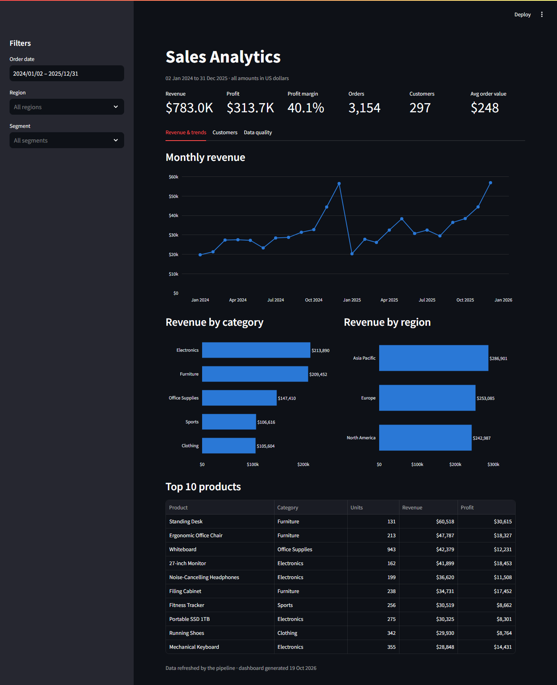
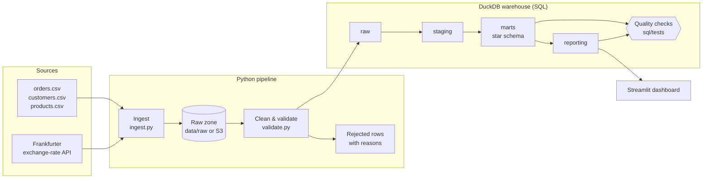
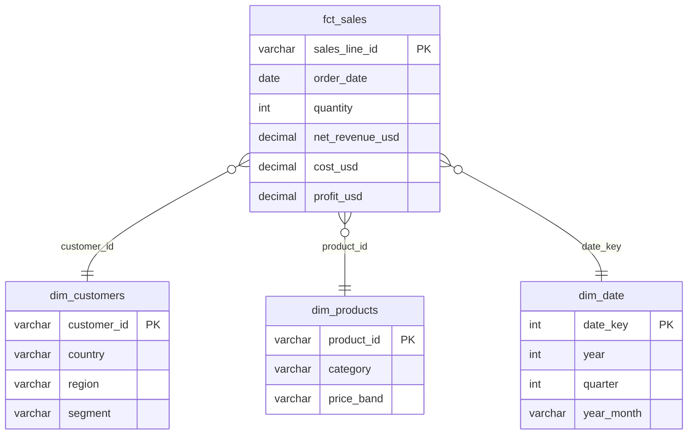

# Automated Sales Analytics Data Platform

An end-to-end data engineering project. It ingests sales data from CSV files and a live
currency API, cleans and validates it with Python, models it into a star schema with SQL,
runs automated data-quality checks, and serves an interactive dashboard. Everything runs
with one command in Docker and is tested on every push with GitHub Actions.




> New to data engineering? [docs/BEGINNER_GUIDE.md](docs/BEGINNER_GUIDE.md) explains every step and every file from scratch.

## Architecture



| Stage | What happens | Industry equivalent |
|---|---|---|
| Ingest | Copy CSVs and API responses, untouched, into a raw zone per run | Fivetran, Airbyte |
| Raw storage | `data/raw/<source>/<run_id>/`, optionally uploaded to S3 | Amazon S3 |
| Clean & validate | pandas rules: schema, types, duplicates, missing values, business rules, referential integrity | Great Expectations |
| Warehouse | DuckDB with `raw`, `staging`, `marts`, `reporting` and `meta` schemas | Snowflake, BigQuery |
| Transform | One SQL file per table, run layer by layer | dbt |
| Quality checks | SQL tests that return failing rows; any failure fails the run | dbt tests, Monte Carlo |
| Orchestration | One Python entry point with logging and exit codes | Airflow, Dagster |
| Dashboard | Revenue, trends, customer performance and data-quality tabs | Looker, Hex, Power BI |

## Data model

`fct_sales` has one row per order line. It joins to three dimensions.



## Data quality

The sample data deliberately contains problems found in real exports. The pipeline handles each one.

| Problem in the source | How it is handled |
|---|---|
| Exact duplicate rows, repeated order lines | Removed and logged as rejected |
| Missing customer or product IDs | Rejected |
| Impossible dates such as `2024-02-30` | Rejected |
| Zero or negative quantities, 150% discounts | Rejected |
| Unknown currency or product | Rejected |
| `" usd "`, `"  germany "`, invalid emails | Fixed and kept |

Every rejected row is saved with its reason in `data/rejected/` and in `raw.rejected_records`.
After the SQL models are built, nine SQL tests check uniqueness, required fields, valid
amounts, referential integrity, future dates and that reporting totals reconcile to the fact table.

## Quick start

**With Docker** (only Docker Desktop needed):

```bash
docker compose up --build
```

Then open http://localhost:8501.

**Without Docker** (Python 3.10+):

```bash
python -m venv .venv
.venv\Scripts\activate          # Windows. On Mac/Linux: source .venv/bin/activate
pip install -r requirements.txt
python -m pipeline.run_pipeline  # add --offline to skip the live API
streamlit run dashboard/app.py
```

Run the tests with `pytest`.

## Project structure

```
├── data/source/          sample input files (generated by scripts/generate_sample_data.py)
├── pipeline/
│   ├── config.py         paths and settings
│   ├── ingest.py         step 1: CSV + API -> raw zone
│   ├── storage.py        raw zone on disk, optional S3 upload
│   ├── validate.py       step 2: cleaning and validation rules
│   ├── warehouse.py      step 3: load into DuckDB
│   ├── transform.py      step 4: run the SQL models
│   ├── quality.py        step 5: run the SQL quality checks
│   └── run_pipeline.py   orchestrator with logging
├── sql/
│   ├── staging/          cast and rename
│   ├── marts/            star schema: facts and dimensions
│   ├── reporting/        dashboard-ready tables
│   └── tests/            quality checks (return failing rows)
├── dashboard/app.py      Streamlit dashboard
├── tests/                pytest unit and end-to-end tests
├── Dockerfile, docker-compose.yml
└── .github/workflows/ci.yml
```

## Tech stack

Python, pandas, SQL, DuckDB, Streamlit, Plotly, Docker, GitHub Actions, pytest, REST APIs, optional AWS S3.

## Possible next steps

- Move the SQL models into **dbt** and the warehouse to **Snowflake** or **BigQuery**.
- Schedule daily runs with **Airflow** or a GitHub Actions cron.
- Load incrementally instead of a full refresh.
- Add an LLM assistant that turns business questions into reviewed, read-only SQL queries.

## About the data

The dataset is synthetic. It is generated by `scripts/generate_sample_data.py` with a fixed
random seed, so it is identical on every machine. Exchange rates come from the free
[Frankfurter API](https://www.frankfurter.app/).
